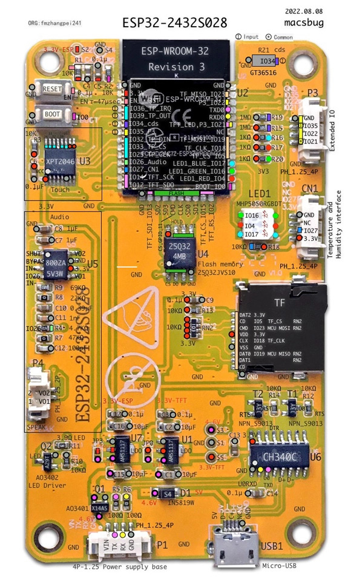
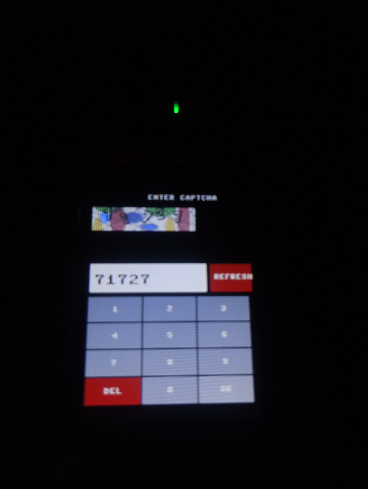

# HSU Student Dashboard (ESP32 CYD)

A MicroPython-based student dashboard designed for the ESP32 CYD (2.8 inch) display. This project interfaces with the Hakim Sabzevari University (HSU) Pooya portal to fetch and display student login credentials and captcha.

## 📸 Project Gallery

Here is a look at the hardware and the user interface running on the ESP32 CYD:

  
   
  <i>ESP32 CYD Hardware Setup</i>

  
   
  <i>Captcha Input Interface with Touch Keypad</i>

## ✨ Features

- Wi-Fi Connectivity: Connects to the university's open Wi-Fi network.
- Secure Session Management: Extracts session cookies and hidden tokens (rand2) from the login page.
- Captcha Rendering: Downloads and renders PNG captchas directly on the CYD display using custom memory optimization to prevent MemoryError.
- Touch Keypad: Includes a calibrated numeric touch keypad for entering the captcha.
- BGR Color Correction: Handles specific ILI9341 panel color byte ordering (BGR) for accurate rendering.
- Immediate Login: Submits the login request immediately after captcha entry to minimize delay.

## ⚠️ Known Issues

- Captcha Timeout: The university server invalidates the captcha session after ~60 seconds. If the device resets between phases or the user types too slowly, the server returns a "Captcha Expired" error.
- Future Fix: Implement a non-blocking architecture or use an external proxy server to bypass the strict timeout.

## 🛠️ Hardware Requirements

- ESP32-2432S028 (CYD 2.8" Display)
- USB Cable

## 🚀 Setup & Installation

1. Flash the latest MicroPython firmware (v1.29.0 or newer) to the ESP32.
2. Upload all the files from the libs/ folder to the root directory of the ESP32.
3. Open main.py and configure your credentials:
   `python
   STUDENT_ID = "your_student_id"
   PASSWORD_HASH = "your_md5_hashed_password"